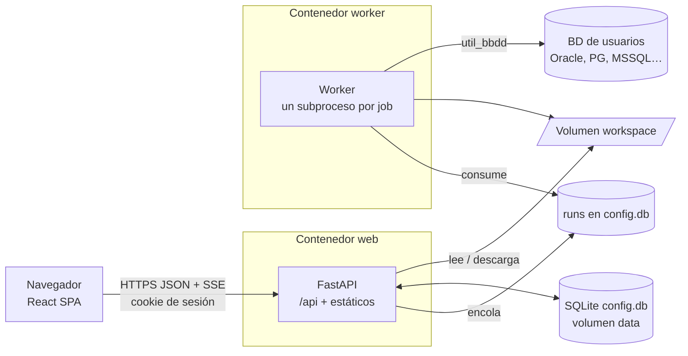
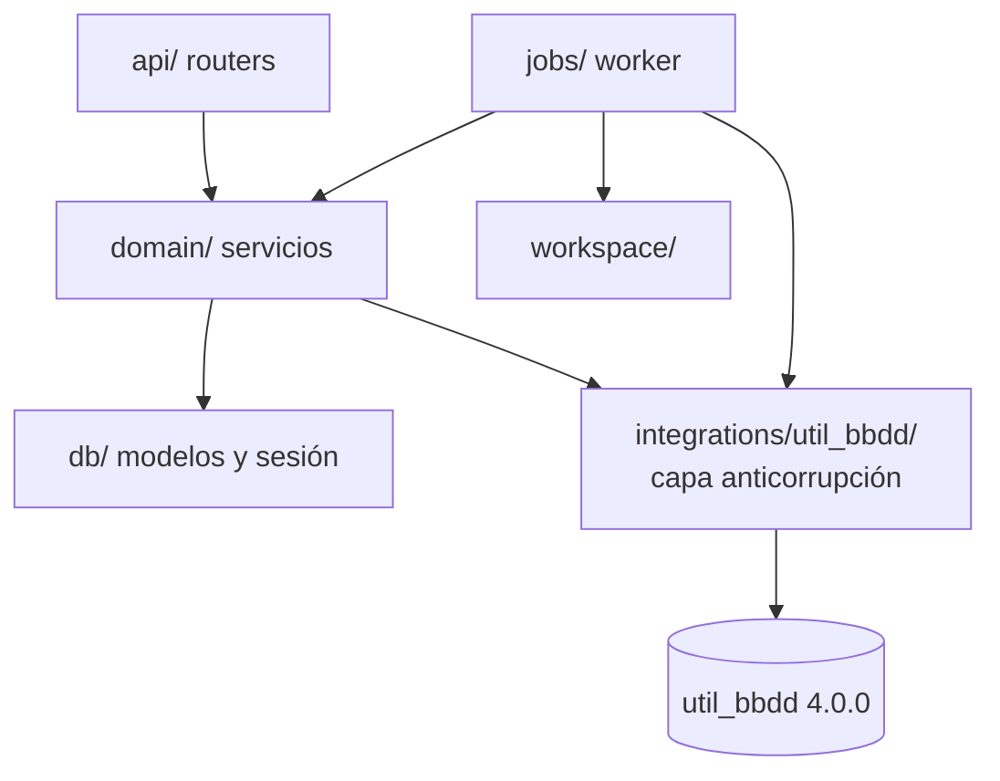

# Arquitectura

## Vista general



- **Un origen**: la API sirve la SPA (`/`) y la API (`/api`); sin CORS.
- **Una imagen**: `web` (uvicorn) y `worker` comparten imagen, volúmenes y secretos.
- **Contrato**: `openapi/openapi.json` genera `frontend/src/api/schema.d.ts`.

## Capas del backend



| Paquete | Responsabilidad | Fase |
|---|---|---|
| `core/` | Ajustes `UBW_*` y Docker secrets, logging JSON, errores RFC 9457, tokens de sesión y CSRF | 0 → 1 |
| `db/` | Engine SQLite con PRAGMA, base declarativa, modelos (`users`, `sessions`, `audit_log`…), Alembic | 0 → |
| `api/` | `/api/health`; `api/v1/` con los routers de negocio | 0 → |
| `integrations/util_bbdd/` | Único importador de util_bbdd: `catalog.py`, `isolated.py` (subproceso con timeout), `probe.py`, `metadata.py` (schemas, snapshot, DDL), `sql.py` (guardián `sqlglot`, solo lectura, queries nombradas), `audit_sink.py` | 0 → 4 |
| `domain/` | `identity/`, `engines/`, `connections/`, `projects/`, `runs/` y `explorer/` (caché de metadatos, queries nombradas, SQL libre) | 1 → 4 |
| `cli.py` | `create-admin` (primer administrador) y `rotate-secrets` (rotación Fernet) | 1 → 2 |
| `jobs/` | Worker (`worker.py`), cola sobre `runs` (`queue.py`), subproceso por job (`runner.py`), contexto y operaciones (`noop`) | 0 → 3 |
| `workspace/` | Carpetas por ejecución, rutas seguras, `run.json`, artefactos, ZIP en *streaming* | 3 |

## Frontend

```text
src/
  app/        # App, Providers (Mantine + TanStack Query), router, Layout, 404
  api/        # client.ts (openapi-fetch) + schema.d.ts (generado)
  features/   # una carpeta por funcionalidad (health, auth, connections, projects, runs…)
  i18n/       # es.json
  components/ # UI compartida (ErrorAlert, NoPermission, formato de fechas)
  test/       # setup de Vitest, render y stub de la API por ruta
```

## Configuración

| Variable | Por defecto (imagen) | Uso |
|---|---|---|
| `UBW_ENVIRONMENT` | `production` | `development` habilita `/api/docs` |
| `UBW_DATA_DIR` | `/data` | `config.db` |
| `UBW_WORKSPACE_DIR` | `/workspace` | Salidas por ejecución |
| `UBW_STATIC_DIR` | `/app/static` | Build del frontend |
| `UBW_LOG_LEVEL` | `INFO` | Nivel de log |
| `UBW_SESSION_IDLE_MINUTES` | `60` | Caducidad de la sesión por inactividad |
| `UBW_SESSION_ABSOLUTE_HOURS` | `12` | Caducidad absoluta de la sesión |
| `UBW_LOGIN_MAX_ATTEMPTS` | `5` | Fallos seguidos que bloquean la cuenta |
| `UBW_LOGIN_LOCKOUT_MINUTES` | `15` | Duración del bloqueo |
| `UBW_PASSWORD_MIN_LENGTH` | `12` | Longitud mínima de contraseña (máximo fijo: 128) |
| Secret `ubw_app_secret_key` | — | Firma del token CSRF; **obligatorio** en producción (sin él la API no arranca) |
| `UBW_FILES_DIR` | `/data/files` | Única carpeta a la que pueden apuntar los parámetros de ruta (SQLite, JAR, certificados) |
| `UBW_CONNECTION_TEST_TIMEOUT` | `15` | Segundos máximos de una prueba o readiness (se mata el subproceso) |
| `UBW_WORKER_CONCURRENCY` | `2` | Jobs simultáneos del worker |
| `UBW_WORKER_POLL_SECONDS` | `1` | Sondeo de la cola y latido |
| `UBW_JOB_TIMEOUT_SECONDS` | `3600` | Duración máxima de un job |
| `UBW_MAX_QUEUED_PER_USER` | `5` | Ejecuciones en cola o en curso por usuario (429) |
| `UBW_USER_QUOTA_MB` | `1024` | Espacio de workspace por usuario (`0` sin límite) |
| `UBW_RUN_RETENTION_DAYS` | `30` | Purga de ejecuciones terminadas más antiguas (`0` desactiva) |
| `UBW_RUN_RETENTION_PER_PROJECT` | `100` | Ejecuciones conservadas por proyecto (`0` desactiva) |
| `UBW_METADATA_TIMEOUT_SECONDS` | `120` | Lectura de schemas, snapshot o DDL |
| `UBW_QUERY_TIMEOUT_SECONDS` | `30` | Queries nombradas y SQL libre |
| `UBW_QUERY_MAX_ROWS` | `1000` | Filas máximas de una consulta (máx. 10 000) |
| Secret `ubw_fernet_keys` | — | Cifrado de conexiones (ADR-004); **obligatorio** en producción |

Decisiones: [ADR-001](adr/ADR-001-stack-y-proyecto-aparte.md) ·
[ADR-002](adr/ADR-002-ejecucion-de-jobs.md) · [ADR-003](adr/ADR-003-autenticacion-sesiones.md) ·
[ADR-004](adr/ADR-004-cifrado-secretos.md) · [ADR-005](adr/ADR-005-workspace-y-ejecuciones.md) ·
[ADR-006](adr/ADR-006-integracion-util-bbdd.md) · [ADR-007](adr/ADR-007-sitio-html-aislado.md).
