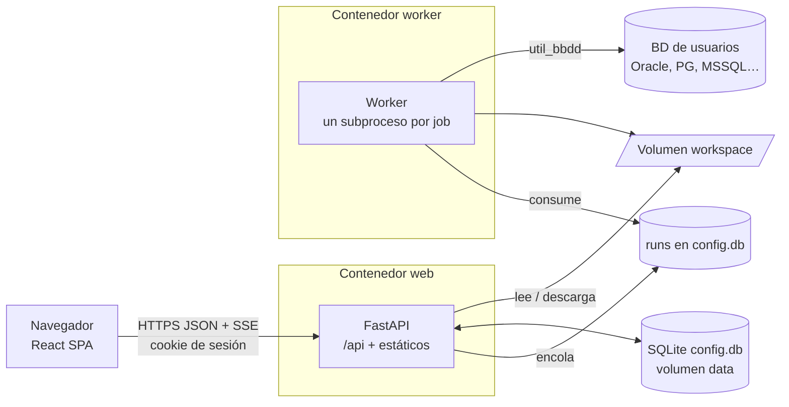
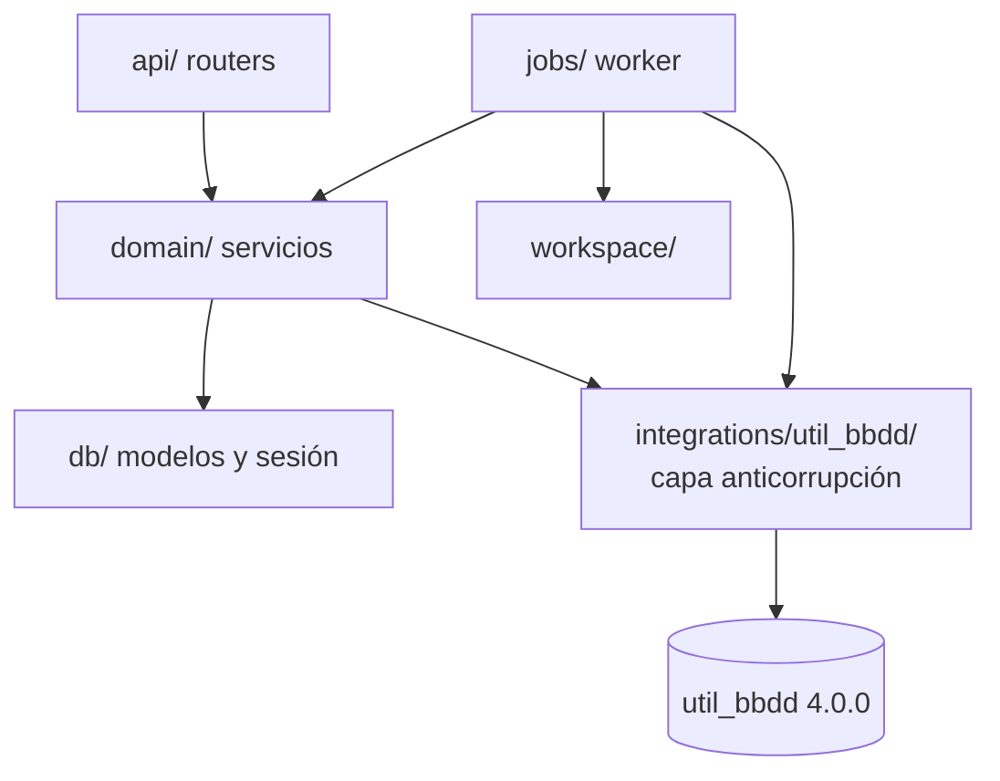

# Arquitectura

## Vista general



- **Un origen**: la API sirve la SPA (`/`) y la API (`/api`); sin CORS.
- **Una imagen**: `web` (uvicorn) y `worker` comparten imagen, volúmenes y secretos.
- **Contrato**: `openapi/openapi.json` genera `frontend/src/api/schema.d.ts`.

## Capas del backend



| Paquete | Responsabilidad | Fase |
|---|---|---|
| `core/` | Ajustes `UBW_*` y Docker secrets, logging JSON, errores RFC 9457 | 0 |
| `db/` | Engine SQLite con PRAGMA, base declarativa, Alembic | 0 |
| `api/` | `/api/health`; `api/v1/` con los routers de negocio | 0 → |
| `integrations/util_bbdd/` | Único importador de util_bbdd | 0 → |
| `domain/` | Usuarios, conexiones, proyectos, ejecuciones | 1 → 3 |
| `jobs/` | Worker, cola, subprocesos, progreso | 0 (esqueleto) → 3 |
| `workspace/` | Carpetas por ejecución, `run.json`, ZIP, retención | 3 |

## Frontend

```text
src/
  app/        # App, Providers (Mantine + TanStack Query), router, Layout, 404
  api/        # client.ts (openapi-fetch) + schema.d.ts (generado)
  features/   # una carpeta por funcionalidad (health, auth, connections, projects, runs…)
  i18n/       # es.json
  test/       # setup de Vitest y utilidades de render
```

## Configuración

| Variable | Por defecto (imagen) | Uso |
|---|---|---|
| `UBW_ENVIRONMENT` | `production` | `development` habilita `/api/docs` |
| `UBW_DATA_DIR` | `/data` | `config.db` |
| `UBW_WORKSPACE_DIR` | `/workspace` | Salidas por ejecución |
| `UBW_STATIC_DIR` | `/app/static` | Build del frontend |
| `UBW_LOG_LEVEL` | `INFO` | Nivel de log |
| Secret `ubw_app_secret_key` | — | Sesiones y CSRF (Fase 1) |
| Secret `ubw_fernet_keys` | — | Cifrado de conexiones (Fase 2) |

Decisiones: [ADR-001](adr/ADR-001-stack-y-proyecto-aparte.md) ·
[ADR-002](adr/ADR-002-ejecucion-de-jobs.md) · [ADR-003](adr/ADR-003-autenticacion-sesiones.md) ·
[ADR-004](adr/ADR-004-cifrado-secretos.md) · [ADR-005](adr/ADR-005-workspace-y-ejecuciones.md) ·
[ADR-006](adr/ADR-006-integracion-util-bbdd.md).
