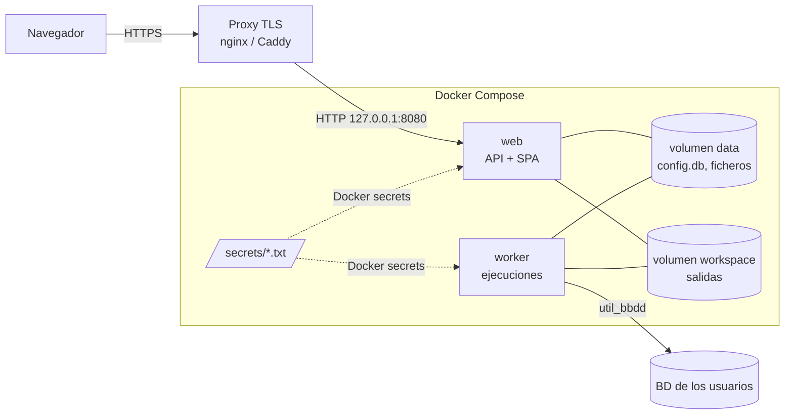

# Puesta en marcha

Cómo arrancar util_bbdd_web **en local** (para probarla o desarrollar) y **en producción** (servidor interno con TLS).
Detalles de operación (proxy, límites, métricas, copias, variantes): [Despliegue](deployment.md). Problemas
frecuentes: [Solución de problemas](troubleshooting.md).

## 1. Qué se pone en marcha



| Pieza | Qué es |
|---|---|
| `web` | API FastAPI que además sirve la SPA; aplica migraciones de `config.db` al arrancar |
| `worker` | Proceso que ejecuta las operaciones de util_bbdd (un subproceso por ejecución); sin él, las ejecuciones se quedan «En cola» |
| `data` | `config.db` (SQLite) y `files/` (ficheros a los que pueden apuntar las conexiones: SQLite, JAR, certificados) |
| `workspace` | Salidas de las ejecuciones y ficheros subidos para la carga bulk |
| `secrets/` | Clave de firma de sesiones/CSRF, claves Fernet de las contraseñas de conexión y, opcional, token de `/metrics` |

Ambos servicios usan la **misma imagen**. No hay credenciales por defecto: el primer administrador se crea con un
comando.

## 2. Requisitos

| Para | Necesitas |
|---|---|
| Ejecutar (local o servidor) | Docker Engine o Docker Desktop con Compose v2, Python 3 (solo para `scripts/generate_secrets.py`), acceso a PyPI, npm y `github.com` al construir la imagen |
| Desarrollar sin Docker | Además: [uv](https://docs.astral.sh/uv/) 0.12.x y Node.js 24 LTS |
| Producción | Un servidor Linux con Docker, un nombre DNS interno, un certificado TLS y un proxy inverso (nginx, Caddy o Traefik) |

Espacio en disco: la imagen ocupa ≈ 770 MB (≈ 1,06 GB con las variantes HSQLDB y ODBC). El workspace crece con las
ejecuciones; por defecto cada usuario tiene una cuota de 1 GB y las ejecuciones se purgan a los 30 días.

## 3. En local

### 3.1. Probar la aplicación (Docker, 5 minutos)

```bash
git clone <repo> util_bbdd_web && cd util_bbdd_web
python scripts/generate_secrets.py      # crea secrets/*.txt (no se versionan)
docker compose up -d --build            # web + worker
docker compose exec web python -m app.cli create-admin --username admin
```

El último comando pide la contraseña dos veces (mínimo 12 caracteres, no puede ser una contraseña común). Abre
<http://127.0.0.1:8080> e inicia sesión. Comprueba el estado en <http://127.0.0.1:8080/api/health>: debe decir
`"status": "ok"` y `"worker": "ok"`.

Aunque sea local, la imagen corre en modo `production`: cookies `Secure` con prefijo `__Host-`. Los navegadores las
aceptan en `127.0.0.1` y `localhost`, pero **no** si entras por la IP o el nombre del equipo sin HTTPS (verías que la
sesión no se mantiene). Para acceder desde otro equipo, sigue la parte de producción.

Parar y volver a arrancar (los datos se conservan en los volúmenes):

```bash
docker compose stop        # o: docker compose down
docker compose up -d
```

Para empezar de cero: `docker compose down -v` (**borra** los volúmenes `data` y `workspace`).

#### Actualizar sin perder los datos

Usuarios, conexiones, proyectos y ejecuciones viven en los volúmenes `data` y `workspace`, y las claves en `secrets/`
(no versionado). Reconstruir la imagen no toca ni unos ni otras. Desde la carpeta del despliegue:

```bash
# 1. Copia de seguridad, fuera de la carpeta del repositorio
docker compose exec web python -m app.cli backup
docker compose cp web:/data/backups ../copias-ubw

# 2. Código nuevo: desde GitHub o directamente desde un clon local de desarrollo (sin publicar)
git pull --ff-only
git pull --ff-only /ruta/al/clon/de/desarrollo develop

# 3. Reconstruir y arrancar (las migraciones se aplican al arrancar)
docker compose up -d --build
curl -s http://127.0.0.1:8080/api/health
```

En el paso 2 usa **una** de las dos líneas. Después, recarga el navegador sin caché (Ctrl+F5): el sitio HTML de la
documentación se guarda en caché hasta 5 minutos. Las ejecuciones ya terminadas conservan sus ficheros; las mejoras
de la generación (por ejemplo, de los diagramas) solo aparecen al lanzarlas de nuevo.

No uses `docker compose down -v` (borra los volúmenes) ni regeneres ni borres `secrets/`: sin `fernet_keys.txt` no se
pueden descifrar las contraseñas de las conexiones. `docker compose down` sin `-v` sí es seguro. Antes de actualizar,
lee el [CHANGELOG](https://github.com/fmanza/util_bbdd_web/blob/develop/CHANGELOG.md).

### 3.2. Desarrollar sin Docker (recarga en caliente)

Tres procesos: API, worker y servidor de Vite. Necesitan los **mismos** ajustes. En especial, la misma clave Fernet:
sin `UBW_FERNET_KEYS` cada proceso inventa una clave efímera distinta, y el worker no podría descifrar las
contraseñas de las conexiones creadas desde la API (además se pierden al reiniciar).

Variables comunes (Git Bash o Linux; los datos van a `backend/data` y `backend/workspace`, ignorados por git):

```bash
python scripts/generate_secrets.py
export UBW_ENVIRONMENT=development
export UBW_FERNET_KEYS="$(cat secrets/fernet_keys.txt)"
export UBW_APP_SECRET_KEY="$(cat secrets/app_secret_key.txt)"
mkdir -p backend/data/files
```

En PowerShell:

```powershell
python scripts/generate_secrets.py
$env:UBW_ENVIRONMENT = "development"
$env:UBW_FERNET_KEYS = (Get-Content secrets/fernet_keys.txt -Raw).Trim()
$env:UBW_APP_SECRET_KEY = (Get-Content secrets/app_secret_key.txt -Raw).Trim()
New-Item -ItemType Directory -Force backend/data/files | Out-Null
```

Después, cada proceso en su terminal (con las variables anteriores definidas en cada una):

```bash
# 1) API en http://127.0.0.1:8000 (la primera vez: migraciones y administrador)
cd backend
uv sync --frozen
uv run --frozen alembic upgrade head
uv run --frozen python -m app.cli create-admin --username admin
uv run --frozen uvicorn app.main:create_app --factory --reload --port 8000

# 2) Worker
cd backend && uv run --frozen python -m app.jobs.worker

# 3) Frontend en http://localhost:5173 (hace de proxy de /api a 127.0.0.1:8000)
cd frontend && npm ci && npm run dev
```

Abre **<http://localhost:5173>**: Vite escucha en `localhost`, que en Windows puede ser `::1`, así que
`http://127.0.0.1:5173` puede no responder. En `development`, las cookies no llevan `Secure` ni el prefijo `__Host-`,
y `/api/docs` (Swagger) está disponible en <http://127.0.0.1:8000/api/docs>.

### 3.3. Desarrollar con la API en Docker

Sin instalar uv: la API corre en Docker con el código montado y recarga en caliente, y el frontend en el equipo.

```bash
python scripts/generate_secrets.py
docker compose -f docker-compose.yml -f docker-compose.dev.yml up -d --build web worker
docker compose -f docker-compose.yml -f docker-compose.dev.yml exec web python -m app.cli create-admin --username admin
cd frontend && npm ci && npm run dev     # http://localhost:5173
```

La API queda en `127.0.0.1:8000`. El worker usa el código de la imagen, no el montado: tras cambiar código de
`jobs/` o de las operaciones, reconstrúyelo (`… up -d --build worker`).

## 4. En producción

Pasos para un servidor Linux interno, con el proxy TLS en el mismo equipo. Referencia completa:
[Despliegue](deployment.md).

### 4.1. Código y versión

```bash
sudo mkdir -p /opt/util_bbdd_web && sudo chown "$USER" /opt/util_bbdd_web
git clone <repo> /opt/util_bbdd_web && cd /opt/util_bbdd_web
git checkout v1.0.0                       # una versión etiquetada, no una rama
```

### 4.2. Secretos

```bash
python3 scripts/generate_secrets.py       # no sobrescribe los que ya existen
sudo chown root:10001 secrets/*.txt       # 10001 = usuario «app» de la imagen
sudo chmod 640 secrets/*.txt
```

Compose monta cada fichero tal cual en `/run/secrets/`, así que el usuario del contenedor (uid 10001) tiene que poder
leerlo. Guarda una copia de `secrets/` fuera del servidor, en un gestor de secretos. **Sin `fernet_keys.txt` no se
pueden descifrar las contraseñas de las conexiones**, ni siquiera restaurando una copia.

### 4.3. Configuración (`.env`)

Compose lee `.env` junto a `docker-compose.yml`. Parte del ejemplo:

```bash
cp .env.example .env
```

Lo mínimo para producción tras un proxy en el mismo equipo es fijar `UBW_TAG` (nombre de la imagen) y
`UBW_FORWARDED_ALLOW_IPS`. Para este último, levanta una vez la aplicación y consulta la pasarela de su red de Docker:

```bash
docker compose up -d --build
docker network inspect util_bbdd_web_default --format '{{(index .IPAM.Config 0).Gateway}}'   # p. ej. 172.18.0.1
```

Pon esa IP en `UBW_FORWARDED_ALLOW_IPS` y vuelve a ejecutar `docker compose up -d`. Sin ella, la aplicación ve la IP
del proxy para todos los usuarios: el límite de peticiones por IP los agrupa, la auditoría no registra la IP real y
no se envía HSTS.

### 4.4. Arrancar y crear el administrador

```bash
docker compose up -d --build
docker compose ps                         # web «healthy», worker «running»
curl -s http://127.0.0.1:8080/api/health  # "status":"ok", "worker":"ok", "version":"1.0.0"
docker compose exec web python -m app.cli create-admin --username admin --display-name "Administración"
```

La aplicación solo escucha en `127.0.0.1:8080` (`UBW_PORT`). No abras ese puerto en el cortafuegos: el acceso es
por el proxy.

### 4.5. Proxy TLS

Configura nginx o Caddy como en [Despliegue › Detrás de un proxy inverso con TLS](deployment.md#detrás-de-un-proxy-inverso-con-tls).
Imprescindible:

- `X-Forwarded-For` y `X-Forwarded-Proto`;
- sin búfer en las respuestas (el progreso usa SSE);
- un límite de cuerpo de al menos 51 MB (subidas de la carga bulk);
- `/metrics` restringido a la red de monitorización.

Comprueba desde otro equipo:

```bash
curl -sI https://util-bbdd.example.internal/ | grep -i -E "strict-transport|content-security"
curl -s https://util-bbdd.example.internal/api/health
```

### 4.6. Configuración inicial en la aplicación

Con el administrador, en este orden:

1. **Administración → Destinos permitidos**: añade los hosts o redes de las bases de datos. Sin esto, ninguna
   conexión de red funciona.
2. **Administración → Usuarios**: crea las cuentas. Concede los permisos especiales solo a quien los necesite:
   *Puede ejecutar SQL libre*, *Puede aplicar DDL* y *Puede escribir datos*.
3. **Conexiones**: crea las conexiones. Para lo que solo lee, usa usuarios de BD de solo lectura y marca
   «Solo lectura» ([detalle](deployment.md#usuarios-de-bd-para-las-conexiones)).
4. **Proyectos**: crea un proyecto, asocia conexiones y añade miembros. Lanza una **Prueba del motor de ejecuciones**
   (`noop`) para validar el worker.

Guía funcional para los usuarios: [Guía de usuario](guia_usuario.md).

### 4.7. Copias, monitorización y actualizaciones

- **Copias diarias** (cron del servidor; conserva las 7 últimas y las saca del servidor):

    ```cron
    0 2 * * * cd /opt/util_bbdd_web && docker compose exec -T web python -m app.cli backup >> /var/log/ubw-backup.log 2>&1 && docker compose exec -T web sh -c 'ls -dt /data/backups/ubw-backup-* | tail -n +8 | xargs -r rm -rf'
    ```

    Copia después `/data/backups` a otro sistema (`docker compose cp web:/data/backups ./copias`). Restauración:
    [Despliegue › Copias de seguridad](deployment.md#copias-de-seguridad).

- **Salud**: vigila `/api/health` (`status` y `worker`). Opcionalmente, Prometheus con `/metrics`
    ([cómo activarlo](deployment.md#logs-y-métricas)).

- **Logs**: `docker compose logs -f web worker` (JSON; la «Referencia» que ven los usuarios en un error es el
    `request_id`).

- **Actualizar** a una versión nueva:

    ```bash
    docker compose exec web python -m app.cli backup
    git fetch --tags && git checkout v<nueva>
    docker compose up -d --build              # las migraciones se aplican al arrancar
    curl -s http://127.0.0.1:8080/api/health
    ```

    Lee antes el [CHANGELOG](https://github.com/fmanza/util_bbdd_web/blob/develop/CHANGELOG.md): al pasar de 0.x
    a 1.0.0 todos los usuarios vuelven a iniciar sesión.

### 4.8. Lista de comprobación

- [ ] `git checkout` de una versión etiquetada; `UBW_TAG` en `.env`
- [ ] `secrets/*.txt` legibles por el uid 10001 y con copia fuera del servidor
- [ ] `/api/health` → `ok` y `worker: ok`; puerto 8080 solo en `127.0.0.1`
- [ ] Proxy TLS con `X-Forwarded-*`, sin búfer, 51 MB de cuerpo y `/metrics` restringido
- [ ] `UBW_FORWARDED_ALLOW_IPS` con la pasarela de la red de Docker
- [ ] Administrador creado; destinos permitidos y usuarios configurados
- [ ] Una ejecución `noop` termina «Correcta»
- [ ] Copia diaria programada y una restauración probada

## 5. Comandos de operación

| Tarea | Comando (desde la carpeta del proyecto) |
|---|---|
| Estado | `docker compose ps` · `curl -s http://127.0.0.1:8080/api/health` |
| Logs | `docker compose logs -f web worker` |
| Crear administrador | `docker compose exec web python -m app.cli create-admin --username <usuario>` |
| Rotar la clave Fernet | Antepón una clave nueva en `secrets/fernet_keys.txt` (separada por coma), `docker compose restart web worker`, `docker compose exec web python -m app.cli rotate-secrets`, retira la antigua del fichero y reinicia otra vez |
| Copia / verificar | `docker compose exec web python -m app.cli backup` · `… verify-backup --from /data/backups/<copia>` |
| Restaurar | Ver [Despliegue › Copias de seguridad](deployment.md#copias-de-seguridad) |
| Copiar un fichero para una conexión | `docker compose cp ./ventas.db web:/data/files/ventas.db` |
| Reiniciar | `docker compose restart web worker` |
