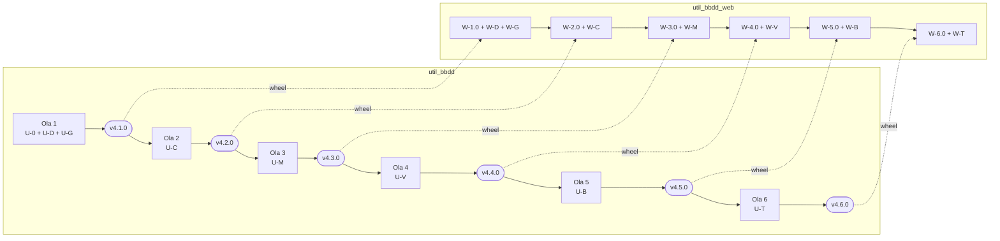

# Plan de resolución de huecos de util_bbdd

Plan para cerrar los huecos de [UTIL_BBDD_GAPS.md](UTIL_BBDD_GAPS.md) **en util_bbdd** y retirar después los rodeos
de la capa anticorrupción de la web. Va agrupado por tipo de ejecución (incluida la **Carga** bulk). Cada grupo
tiene sus fases, y **cada fase es un commit** en un solo repositorio.

- **Estado**: PLAN + AUDIT_PLAN emitidos (2026-10-25); decisiones D1-D5 resueltas el mismo día (§4). Ola 1 y W-1
  hechas (util_bbdd 4.1.0, web 1.1.0). Ola 2 y W-2 hechas (util_bbdd 4.2.0, web 1.2.0; registro en §6).
  Ola 3 y W-3 hechas (util_bbdd 4.3.0, web 1.3.0; registro en §6). Ola 4 y W-4 hechas (util_bbdd 4.4.0, web
  1.4.0; registro en §6). Ola 5 hecha (util_bbdd 4.5.0); W-5 en curso.
- **Base**: util_bbdd `4.0.1` (rama de trabajo) · util_bbdd_web `1.0.0` + cambios sin publicar, que fija
  util_bbdd `4.0.0` (wheel de GitHub Releases, ADR-006).
- **Sesión**: `.ai/sessions/2026-10-25-plan-gaps/`.
  En util_bbdd: `.ai/sessions/2026-10-25-web-gaps-plan/`.

---

## 1. Reglas del plan

1. **La web no parchea util_bbdd** (regla 1 de SHARED). Cada hueco se arregla en util_bbdd, se publica una release
   y solo entonces la web retira su rodeo.
2. **Una fase = un commit = un repositorio.** Prefijos: `U-` para util_bbdd y `W-` para util_bbdd_web. Cada commit
   deja en verde los «Comandos de desarrollo» de su repositorio (en util_bbdd: ruff, mypy, pytest y
   `zensical build --strict` si se toca `docs/`; en la web: backend, contrato OpenAPI y frontend).
3. **Una release de util_bbdd por ola** (MINOR `4.x.0`, con el wheel adjunto en GitHub Releases). La web sube de
   versión **en un commit propio** (`W-x.0`), sin mezclarlo con cambios de código.
4. **SemVer en util_bbdd.** En 4.x solo hay parámetros nuevos opcionales, correcciones y avisos. Los cambios de
   valor por defecto (G30, G35) llevan antes un `FutureWarning` y se cambian en una MAJOR aparte (ola 8, fuera de este plan: D4).
5. **Rodeo retirado o mantenido.** Cada fase `W-` dice si el rodeo **se retira** o **se mantiene como defensa en
   profundidad** (los guardianes de seguridad de la web se quedan aunque util_bbdd arregle el hueco).
6. **Compatibilidad con lo ya guardado.** Lo que la web haya escrito con el rodeo (p. ej. `diff.json` formato 1,
   `plan.json` de ADR-008) se sigue leyendo después del cambio.
7. Al cerrar cada fase `W-`, la fila del hueco en `UTIL_BBDD_GAPS.md` pasa a **Resuelto en util_bbdd 4.x.0**.

### Huecos sin trabajo

| # | Motivo |
|---|---|
| G9 | Informativo: excepción de `exclude-newer` para asyncpg. Se revisa en cada `W-x.0` y se quita cuando el corte la cubra |
| G16 | Informativo: `init_command` sigue bloqueado en la web por diseño (`kind=blocked`) |
| G7 | Informativo: deuda interna de util_bbdd. Fase opcional `U-C5`, sin fase `W-` |

---

## 2. Grupos y fases

Convención de cada fase: **id** · tipo de commit (Conventional Commits) · huecos · cambio · ficheros principales ·
tests mínimos.

### Grupo 0 — Transversal base (antes que todos los grupos)

Contrato común de progreso y cancelación (G1), que después conecta cada tipo de ejecución, y extras de drivers (G3).

| Id | Commit | Huecos | Cambio | Ficheros | Tests |
|---|---|---|---|---|---|
| U-0.1 | `feat(progress): contrato de progreso y cancelación cooperativa` | G1 | Paquete público nuevo `util_bbdd.progress` (capa 2, Foundation: solo importa `_core`): `ProgressEvent` (operación, fase, actual, total, mensaje), `ProgressCallback` y `CancellationToken` (`is_cancelled()`); excepción `OperationCancelledError` en la jerarquía. Solo el contrato: nadie lo usa todavía. Se añade a `LAYER` del script de capas y se regenera la figura | `progress/__init__.py` (nuevo), `_core/exceptions.py`, `exceptions.py`, `scripts/gen_arquitectura_capas.py`, `docs/architecture.md`, `docs/api/` + `mkdocs.yml`, `.github/SHARED_INSTRUCTIONS.md` (árbol y submódulos públicos), `docs/guides/api_1_0_migration.md` | Unitarios del token y del evento; `test_protocol_conformance`; `gen_arquitectura_capas.py` sin errores |
| U-0.2 | `chore(deps): extras sqlserver, hsqldb y sqlite-async` | G3 | Extras `sqlserver = ["pymssql>=2.4"]`, `hsqldb = ["jaydebeapi…"]` y `sqlite-async = ["aiosqlite…"]`, con las mismas cotas que ya usa la web | `pyproject.toml`, `docs/` (instalación) | `pip install -e ".[sqlserver,hsqldb,sqlite-async]"` en el CI |

Decisión D1 (aprobada): paquete nuevo `util_bbdd.progress`, separado de `audit` (el progreso no es auditoría). Va en
la capa 2 para que lo puedan importar `analysis`, `comparar`, `migrate`, `bulk` (capa 6), `doc` y `dump` (capa 7) sin
romper la Regla #6. Al ser un submódulo público nuevo, entra en la lista de submódulos con SemVer.

### Grupo D — Documentación (`documentation`)

| Id | Commit | Huecos | Cambio | Ficheros | Tests |
|---|---|---|---|---|---|
| U-D1 | `fix(doc): ventana de nombre de salida por instancia` | G2 | El caché `_LAST_AUTO_OUTPUT_BY_KEY` pasa de atributo de clase a estado de la instancia (o la clave incluye `directorio_salida`): dos instancias no comparten carpeta. La ventana por defecto se mantiene | `doc/infrastructure/runtime/output_runtime.py`, `doc/database_documentation.py` | Dos instancias en la misma ventana → dos carpetas |
| U-D2 | `fix(doc): un diagrama que falla no aborta el formato` | G39 (a) | Los renderers HTML y Word capturan también `graphviz.CalledProcessError` y `graphviz.ExecutableNotFound` por diagrama: aviso en el resultado y el resto sigue | `doc/infrastructure/renderers/html_generator.py`, `word_generator.py` | Doble de `graphviz` que lanza `CalledProcessError` → documento completo + aviso |
| U-D3 | `feat(analysis): opción orthogonal_edges en los diagramas` | G39 (b) | `orthogonal_edges: bool = True` en `GraphvizRelationshipGraphExt` y en `imprimir` (`splines=ortho` o `polyline`) | `analysis/graphviz_ext.py`, `doc/infrastructure/renderers/shared/print_config_manager.py` | DOT generado con cada valor |
| U-D4 | `fix(doc): validar los estilos de plantilla_word` | G41 | `settings()` comprueba `Title`, `Heading 1`-`3` y `No Spacing` en la plantilla y lanza `DocumentationConfigError` con los que faltan, antes de generar nada | `doc/infrastructure/renderers/shared/print_config_manager.py`, `word_generator.py` | Plantilla sin `Heading 1` → `DocumentationConfigError` y ningún fichero |
| U-D5 | `fix(doc): diagrama de tabla sin relaciones en HTML` | G38 | `pipe_level_graphs_ext` dibuja la tabla sola (como Word) en lugar de descartar el nivel vacío | `analysis/graphviz_ext.py`, `doc/infrastructure/renderers/html_generator.py` | 3 tablas sin FK → 3 diagramas en HTML |
| U-D6 | `fix(metadata): schema explícito en Oracle` | G21 | `MetadataContextResolver` respeta el `schema` pedido en Oracle (`ALL_*` filtrado por `OWNER`, nombre desnormalizado) en lugar de usar siempre el usuario | `managers/_metadata_context.py`, `metadata/oracle/` | Unitarios del resolver; integración Oracle (`-m integration`) |
| U-D7 | `feat(doc,analysis): argumento schema explícito` | G22 | `DatabaseDocumentation(..., schema=None)` y `GraphvizRelationshipGraphExt(..., schema=None)`; si es `None` se mantiene la lectura de `conn_params` | `doc/database_documentation.py`, `analysis/graphviz_ext.py` | SQLite y dobles de manager: el schema llega al `SchemaSnapshot` |
| U-D8 | `feat(doc): plantilla_excel y colores del tema` | G40 | `imprimir["plantilla_excel"]` (libro base, con hoja de portada opcional), colores del tema en lugar de los RGB fijos y `table_style_excel` separado de `table_style` | `doc/infrastructure/renderers/excel_generator.py`, `print_config_manager.py` | Ningún RGB fijo en el libro; la plantilla aporta tema, fuentes y página |
| U-D9 | `feat(doc): progreso y cancelación en generate()` | G1 | `DatabaseDocumentation(..., on_progress=None, cancel_token=None)`: eventos por formato y por tabla; cancelación entre tablas | `doc/database_documentation.py`, `doc/application/use_cases/documentation_orchestrator.py` | Secuencia de eventos; cancelar → `OperationCancelledError` sin ficheros a medias |

| Id | Commit | Huecos | Cambio en la web | Rodeo |
|---|---|---|---|---|
| W-D1 | `fix(backend): documentación con el schema pedido en todos los motores` | G21, G22 | Quitar `with_schema` y el rechazo `invalid_params` de Oracle; pasar `schema=`. El aviso del formulario desaparece | Se retira |
| W-D2 | `docs: plantilla Word validada por util_bbdd 4.1.0` | G41 | **Cambio al ejecutar (2026-10-26)**: se **mantiene** el «regenerar sin plantilla con aviso» (ADR-011, decisión 7). util_bbdd 4.1.0 falla al construir, antes de leer la BD, así que el reintento ya no cuesta una segunda lectura; quitarlo haría fallar ejecuciones que hoy terminan con aviso. W-1.0 ya reconoce el error nuevo. Solo documentación (ADR-011, GAPS) | Se mantiene |
| W-D3 | `fix(backend,frontend): diagramas fallidos sin perder la documentación` | G39 | Quitar el error fatal `graphviz_failed`; mostrar los avisos por diagrama del resultado. Opción «Aristas ortogonales» en el formulario (`orthogonal_edges`) | `docker/dot-wrapper.sh` **se mantiene**: reintenta en polyline en lugar de omitir el diagrama |
| W-D4 | `refactor(backend): plantilla Excel nativa de util_bbdd` | G40 | `excel_template.py` deja de retocar el libro y pasa `plantilla_excel` + `table_style_excel`. Enmienda de ADR-011. El test «ningún color fijo» se queda | Se retira |
| W-D5 | `feat(backend,frontend): progreso real y cancelación de la documentación` | G1 | `on_progress` → eventos SSE del run; cancelar pone el token y, si no termina en N s, se mata el subproceso (ADR-002 enmendado) | Kill del subproceso: se mantiene como último recurso |
| W-D6 | `docs: documentación sin rodeos G2, G38` | G2, G38 | Quitar el aviso de G38 de la guía; `batch_window_seconds=0` y `fichero_salida` explícito **se mantienen** (no cuestan nada). Actualizar GAPS | — |

### Grupo G — Grafo de relaciones (`relationship_graph`)

Reutiliza U-D3 (aristas ortogonales), U-D6/U-D7 (schema) y U-D5 (tabla sola), que salen en la misma release.

| Id | Commit | Huecos | Cambio | Ficheros | Tests |
|---|---|---|---|---|---|
| U-G1 | `feat(analysis): progreso y cancelación en los grafos` | G1 | `on_progress` / `cancel_token` en `generate_all_tables_graphs_ext` y `generate_graphviz_graph_paginated_ext` (evento por tabla o página) | `analysis/graphviz_ext.py` | Eventos por tabla; cancelación entre tablas |
| W-G1 | `feat(backend,frontend): grafo con schema, aristas ortogonales y progreso` | G1, G21, G22, G39 | Mismo cambio que W-D1/W-D3/W-D5 aplicado a la operación de grafo | Se retira `with_schema` del grafo |

### Grupo C — Comparación de esquemas (`compare`)

| Id | Commit | Huecos | Cambio | Ficheros | Tests |
|---|---|---|---|---|---|
| U-C1 | `security(comparar): etiquetas configurables sin datos de conexión` | G23 | `compare(..., source_label=None, target_label=None)`. Sin etiqueta, `_build_label` usa `motor [schema]` (sin host, puerto, usuario ni ruta). Los nombres de fichero de los reporters no llevan datos de conexión | `comparar/comparator.py`, `comparar/reporters/` | Ninguna etiqueta ni nombre de fichero contiene host, usuario ni ruta |
| U-C2 | `feat(comparar): SchemaDiff.to_dict/from_dict versionado` | G24 | Serialización estable con `format_version` y *round-trip* exacto | `comparar/models.py` | *Round-trip*; versión desconocida → error claro |
| U-C3 | `security(comparar): Mermaid sin CDN flotante` | G25 | Versión exacta con SRI y `mermaid_src` configurable (URL o fichero local); el script del informe funciona sin Mermaid (pestañas, filtros y búsqueda), con los diagramas como texto | `comparar/reporters/templates/diff_report.html.j2`, reporter HTML | HTML sin red: los controles funcionan; la etiqueta lleva `integrity` |
| U-C4 | `feat(comparar): progreso y cancelación` | G1 | `on_progress` / `cancel_token` en `compare()` (por tipo de objeto y tabla) | `comparar/comparator.py` | Eventos; cancelación |
| U-C5 *(opcional)* | `refactor(comparar): aceptar SchemaSnapshot` | G7 | `compare()` acepta también `SchemaSnapshot` (ADR-003 de util_bbdd) sin quitar `Inspector` | `comparar/comparator.py` | Mismo `SchemaDiff` con `Inspector` y con `SchemaSnapshot` |

| Id | Commit | Huecos | Cambio en la web | Rodeo |
|---|---|---|---|---|
| W-C1 | `refactor(backend): etiquetas de comparación desde util_bbdd` | G23 | Pasar `source_label`/`target_label` = `alias (motor) [schema]`; `relabel` se reduce a nada o se borra | Se retira. Se mantiene el test «ningún host en visor ni informes» |
| W-C2 | `refactor(backend): diff serializado por util_bbdd` | G24 | `SchemaDiff.to_dict()` para escribir; la lectura acepta el formato 1 propio (runs antiguos) y el de util_bbdd. La evolución entre ejecuciones sigue funcionando con runs mezclados | Escritura retirada; lector del formato 1 **se mantiene** |
| W-C3 | `security(backend): Mermaid empaquetado en el informe HTML` | G25 | Pasar `mermaid_src` a un asset propio servido con la CSP del visor (o seguir sin Mermaid). Quitar la sustitución por `mermaid-stub.js` | Se retira el stub |
| W-C4 | `feat(backend,frontend): progreso real de la comparación` | G1 | Como W-D5 | Kill: último recurso |

### Grupo M — Migración DDL (`migrate_plan` / `migrate_apply`)

| Id | Commit | Huecos | Cambio | Ficheros | Tests |
|---|---|---|---|---|---|
| U-M1 | `feat(migrate): consulta pública de motores de migración` | G4 | `MigrationPlanner.supported_sources()` / `supported_targets()` (o `get_migration_engines()` en `migrate/__init__.py`) que devuelve las constantes | `migrate/planner.py`, `migrate/__init__.py` | Coincide con las constantes privadas |
| U-M2 | `fix(migrate): la FK recibe el tipo de la columna referenciada` | G28 | Después de transformar, cada columna FK toma el tipo destino de la columna que referencia. Si no puede, aviso de nivel `ERROR` | `migrate/transformers/oracle_to_*.py` (o un paso común en `migrate/ir/`) | Oracle `INT` PK + FK → mismo tipo en MariaDB, MySQL, SQL Server y PostgreSQL |
| U-M3 | `feat(migrate): MigrationPlan serializable` | G26 | `MigrationPlan.to_dict()/from_dict()` con `format_version` y `statements_sha256`; `execute()` sobre un plan reconstruido | `migrate/ir/models.py` | *Round-trip*; mismo `emit_statements()` |
| U-M4 | `feat(migrate): check_target y modo seco` | G27 | `MigrationPlan.check_target(connection)` → conflictos (tablas y vistas existentes, vistas inválidas); `execute(..., dry_run=False, stop_on_error=True)` informa de la sentencia que falla (índice y SQL). La atomicidad no es posible en DDL de MySQL/Oracle: se documenta | `migrate/ir/models.py`, `migrate/_audit_events.py` | SQLite/dobles: conflicto detectado; `dry_run` no escribe; fallo → índice |
| U-M5 | `feat(migrate): progreso y cancelación en execute()` | G1 | Evento por sentencia; cancelación entre sentencias | `migrate/ir/models.py` | Eventos; cancelación |

| Id | Commit | Huecos | Cambio en la web | Rodeo |
|---|---|---|---|---|
| W-M1 | `refactor(backend): motores de migración desde la API pública` | G4 | `MIGRATE_SOURCE/TARGET` salen de U-M1; borrar el test que lee las constantes privadas | Se retira |
| W-M2 | `fix(backend): FK con tipos coherentes` | G28 | `fk_mismatches` se queda como comprobación (debería devolver vacío); el bloqueo `fk_blocking` se mantiene para planes antiguos | Se mantiene como defensa |
| W-M3 | `refactor(backend): aplicar el plan revisado sin replanificar` | G26, G27 | Guardar `plan.to_dict()`; al aplicar, `from_dict()` + comprobación del hash (ADR-008 enmendado) y `check_target()` en lugar del conflicto propio. El modo seco obligatorio y la doble confirmación **no cambian**. Los `plan.json` antiguos se replanifican como hasta ahora | Se retira la replanificación; el control de ADR-008 se mantiene |
| W-M4 | `feat(backend,frontend): progreso por sentencia en migrate_apply` | G1 | Como W-D5. La cancelación de la aplicación sigue **desactivada** (DDL a medias) salvo entre sentencias con confirmación | — |

### Grupo V — Volcado de datos (`dump`)

| Id | Commit | Huecos | Cambio | Ficheros | Tests |
|---|---|---|---|---|---|
| U-V1 | `feat(dump): DumpOrchestrator.plan()` | G29 | `plan()` → `DumpPlan` (`load_order`, `cycles`, tablas sin destino, avisos) sin escribir, con el mismo `topological_sort` que `run()` | `dump/orchestrator.py`, `dump/_fk_graph.py`, `dump/_models.py` | `plan().load_order == run().load_order` |
| U-V2 | `feat(dump): eventos de auditoría durante el volcado` | G6 | `audit_sink` recibe el evento de cada tabla al terminar esa tabla (no todos al final); el evento de cierre se mantiene | `dump/orchestrator.py`, `dump/_audit_events.py` | El sink recibe eventos antes del cierre |
| U-V3 | `fix(dump): registro y restauración de constraints` | G31 | Diario `constraints_journal.json` en `output_dir` antes de desactivar; `restore_constraints(journal)` público e idempotente | `dump/_constraints.py`, `dump/orchestrator.py` | Proceso interrumpido simulado → `restore_constraints` deja todo activo |
| U-V4 | `fix(dump): isolate aparta ORA-00001 en Oracle` | G32 | `on_error="isolate"` trata `ORA-00001` como el resto de duplicados | `dump/orchestrator.py`, `dump/_sql_utils.py` | Unitario con error simulado; integración Oracle |
| U-V5 | `fix(dump): fechas ISO de SQLite al leer` | G33 | Lectura desde SQLite: texto ISO en columnas `DATE`/`DATETIME` → `date`/`datetime` | `dump/_source_reader.py` | SQLite → SQLite con fechas en texto: vuelca |
| U-V6 | `security(dump): mensajes de error sin datos de negocio` | G34 | `error_msg` sin parámetros de SQLAlchemy ni valores de clave (primera línea + enmascarado) | `dump/_models.py`, `dump/orchestrator.py`, `dump/_constraints.py` | Errores simulados de MySQL, MariaDB y SQL Server sin valores |
| U-V7 | `feat(dump): aviso si truncate_target no es explícito` | G30 | `FutureWarning` cuando se construye `DumpConfig` sin `truncate_target` explícito; el cambio de valor por defecto se deja para la 5.0 (ola 8, D4) | `dump/_models.py` | Aviso con el valor por defecto; sin aviso si es explícito |
| U-V8 | `feat(dump): progreso y cancelación cooperativa` | G1 | Evento por tabla y por lote; cancelar entre lotes **restaura constraints e índices** antes de salir | `dump/orchestrator.py` | Cancelar → constraints restauradas y `OperationCancelledError` |

| Id | Commit | Huecos | Cambio en la web | Rodeo |
|---|---|---|---|---|
| W-V1 | `refactor(backend): vista previa del volcado con plan()` | G29 | `build_preview` usa `DumpOrchestrator.plan()`; el test que comparaba el orden replicado se cambia por uno de contrato | Se retira la réplica del orden |
| W-V2 | `feat(backend,frontend): avance por tabla y cancelación del volcado` | G1, G6 | Avance por tabla en vivo; el volcado **pasa a ser cancelable** (cooperativo, con restauración) | Se retira «volcado no cancelable» |
| W-V3 | `fix(backend): restaurar constraints tras un volcado interrumpido` | G31 | Si el run muere (timeout o kill), el worker llama a `restore_constraints(journal)` al detectar el run huérfano; acción manual «Restaurar constraints» para owner | Nuevo control; se quita el aviso de la guía |
| W-V4 | `fix(backend,frontend): quitar los avisos isolate_oracle y sqlite_dates` | G32, G33 | Fuera los avisos de la vista previa; los tests que reproducían los fallos pasan a comprobar que se vuelca | Se retira |
| W-V5 | `security(backend): mensajes del volcado` | G34 | `redact_values` **se mantiene** como defensa; `_engine_message` se simplifica | Se mantiene |

G30: la web ya pasa `truncate_target` explícito y con confirmación «VACIAR». No hace falta fase `W-`.

### Grupo B — Carga bulk (`bulk`)

| Id | Commit | Huecos | Cambio | Ficheros | Tests |
|---|---|---|---|---|---|
| U-B1 | `fix(bulk): contadores de filas fiables` | G37 | `rows_committed` / `last_operation_rows_committed` = suma de `rowcount` confirmado por lote (insert, update y delete, secuencial y paralelo) | `bulk/_execution/executors.py`, `session.py`, `parallel_loader.py`, `bulk/crud.py` | SQLite: contador == filas reales en las 3 operaciones, con lotes y con paralelo |
| U-B2 | `feat(bulk): ParallelPlan.atomic` | G36 | `ParallelPlan.atomic: bool` (False si hay más de un hilo) documentado; `parallel=ParallelOptions(require_atomic=True)` opcional fuerza un hilo | `bulk/_execution/parallel_planner.py`, `bulk/options.py` | Plan de 1 y de N hilos |
| U-B3 | `feat(bulk): dry_run explícito y aviso de generar_sql` | G35 | `dry_run: bool \| None = None` en `bulk_*_from_df` / `_from_chunks` (equivalente explícito de `generar_sql=True`); `FutureWarning` si no se pasa ninguno de los dos. El cambio de valor por defecto, en la 5.0 | `bulk/crud.py` | Aviso sin argumentos; `dry_run=True` no escribe |
| U-B4 | `feat(bulk): progreso y cancelación por lote` | G1 | Evento por lote; cancelar entre lotes (con rollback del lote en curso en modo secuencial) | `bulk/crud.py`, `bulk/_execution/` | Eventos; cancelación sin filas del lote cancelado |

| Id | Commit | Huecos | Cambio en la web | Rodeo |
|---|---|---|---|---|
| W-B1 | `refactor(backend): resultado de la carga con los contadores de util_bbdd` | G37 | Los contadores son la cifra principal; el recuento antes/después del destino **se mantiene** como verificación (aviso si no coinciden) | Se mantiene como defensa |
| W-B2 | `refactor(backend): atomicidad desde ParallelPlan.atomic` | G36 | `accept_non_atomic` se pide solo si `plan.atomic is False` | Se retira la deducción propia |
| W-B3 | `feat(backend,frontend): progreso por lote y cancelación de la carga` | G1 | Como W-D5 | Kill: último recurso |

G35: la web pasa `generar_sql` explícito (y pasará `dry_run`). No hace falta fase `W-` propia: entra en W-B1.

### Grupo T — Transversal: catálogo, conexiones y explorador

No son tipos de ejecución, pero quedan huecos abiertos en GAPS. Van al final porque no bloquean ninguna operación.

| Id | Commit | Huecos | Cambio | Ficheros | Tests |
|---|---|---|---|---|---|
| U-T1 | `feat(core): matriz de capacidades y estado de drivers` | G5, G10 | `get_engine_capabilities(db_type)` (async, migración origen/destino, readiness, grafos, volcado, bulk) y `get_driver_status(db_type)` (instalado / ausente por driver) | `core/capabilities.py`, `_drivers/` | Todos los motores; driver ausente simulado |
| U-T2 | `fix(data): drivers obsoletos y driver_info homogéneo` | G8, G14 | Fuera `cx_Oracle`; `driver_info` homogéneo **sin romper**: se añade `default_driver` en todos los motores y la lista de SQL Server se conserva | `data/database_types.json`, `_drivers/_config_loader.py` | Esquema del JSON |
| U-T3 | `feat(data): kind por parámetro de conexión` | G12 | `kind`: `secret`, `path`, `host`, `port`, `plain`, `blocked` en cada `connection_params` | `data/database_types.json`, `connection/params.py` | Todos los parámetros tienen `kind` |
| U-T4 | `fix(connection): conservar los opcionales declarados` | G15 | `build_conn_params` conserva los opcionales declarados en `connection_params` (p. ej. `sslmode`) | `connection/builder.py` | `sslmode` en PostgreSQL sobrevive |
| U-T5 | `security(managers): get_database_info sin secretos` | G11 | `connection_params` con secretos enmascarados (`***`) según `kind` (U-T3) | `managers/sync_mgr.py`, `managers/async_mgr.py` | Ningún secreto en la salida |
| U-T6 | `feat(managers): ping, versión del servidor y schemas` | G13, G17 | `ping()`, `get_server_version()` y `get_schema_names()` (Oracle desnormalizado) en los dos managers | `managers/` | SQLite; dobles para Oracle |
| U-T7 | `security(query): validar todos los parámetros de las queries` | G18 | Todos los parámetros interpolados se validan como identificador o número; opción de *bind* para valores | `query/resolver.py`, `validators/` | Valor con `;` o comillas → rechazo |
| U-T8 | `feat(managers): read_only y max_rows en execute_custom_*` | G19, G20 | `execute_custom_many/one(..., read_only=False, max_rows=None)` con transacción de solo lectura por motor y `fetchmany` | `managers/sync_mgr.py`, `managers/async_mgr.py`, `executors/` | SQLite `PRAGMA query_only`; `max_rows` corta |

| Id | Commit | Huecos | Cambio en la web | Rodeo |
|---|---|---|---|---|
| W-T1 | `refactor(backend): ficha de motor desde get_engine_capabilities` | G5, G8, G10, G14 | `EngineCapabilities`, `OBSOLETE_DRIVERS`, `find_spec` y la elección de la primera opción, desde la API | Se retiran |
| W-T2 | `refactor(backend): clasificación de parámetros desde util_bbdd` | G12, G15 | `param_kind` lee `kind`; `KNOWN_PARAMS` y su test se quedan como alarma de parámetros nuevos; `build_params` sin la mezcla | Se retira la mezcla; la alarma se mantiene |
| W-T3 | `refactor(backend): prueba de conexión y schemas con la API del manager` | G13, G17 | `probe.py` y `metadata.py` usan `ping()`, `get_server_version()` y `get_schema_names()` | Se retira |
| W-T4 | `security(backend): SQL libre con read_only y max_rows` | G18, G19, G20 | Pasar `read_only=True` y `max_rows`. El guardián `sqlglot`, la transacción propia y la validación de parámetros **se mantienen** | Se mantienen como defensa |

G11: la web no usa `get_database_info()`; no hace falta fase `W-`.

---

## 3. Orden de ejecución simultáneo

Los dos repositorios avanzan **en tubería**: mientras la web adapta la ola *n* (ya publicada), util_bbdd implementa
la ola *n+1*. El único punto de sincronización es la release (tag + wheel) de util_bbdd.



| Paso | util_bbdd (commits en orden) | util_bbdd_web (commits en orden) | Sincronización |
|---|---|---|---|
| 0 | — | `docs(plan)`: este plan (commit de esta sesión) | — |
| 1 ✅ | U-0.1 → U-0.2 → U-D1 → U-D2 → U-D3 → U-D4 → U-D5 → U-D6 → U-D7 → U-D8 → U-D9 → U-G1 → **`release: v4.1.0`** (`4b67b05`) | (libre: se puede publicar la 1.1.0 de la web con lo que tiene sin publicar) | Tag `v4.1.0` + wheel y `.sha256` en la release |
| 2 (web ✅) | U-C1 → U-C2 → U-C3 → U-C4 → (U-C5) → **`release: v4.2.0`** | **W-1.0** `chore(backend): util_bbdd 4.1.0` (incluye retirar los drivers propios de G3 si se pasan a extras) → W-D1 → W-D2 → W-D3 → W-D4 → W-D5 → W-G1 → W-D6 → **`release: v1.1.0`** | La web arranca cuando existe el wheel 4.1.0 |
| 3 | U-M1 → U-M2 → U-M3 → U-M4 → U-M5 → **`release: v4.3.0`** | **W-2.0** `chore(backend): util_bbdd 4.2.0` → W-C1 → W-C2 → W-C3 → W-C4 → **`release: v1.2.0`** | Wheel 4.2.0 |
| 4 (web ✅) | U-V1 → U-V2 → U-V3 → U-V4 → U-V5 → U-V6 → U-V7 → U-V8 → **`release: v4.4.0`** | **W-3.0** `chore(backend): util_bbdd 4.3.0` → W-M1 → W-M2 → W-M3 → W-M4 → **`release: v1.3.0`** | Wheel 4.3.0 |
| 5 (web ✅) | U-B1 → U-B2 → U-B3 → U-B4 → **`release: v4.5.0`** | **W-4.0** `chore(backend): util_bbdd 4.4.0` → W-V1 → W-V2 → W-V3 → W-V4 → W-V5 → **`release: v1.4.0`** | Wheel 4.4.0 |
| 6 | U-T1 → U-T2 → U-T3 → U-T4 → U-T5 → U-T6 → U-T7 → U-T8 → **`release: v4.6.0`** | **W-5.0** `chore(backend): util_bbdd 4.5.0` → W-B1 → W-B2 → W-B3 → **`release: v1.5.0`** | Wheel 4.5.0 |
| 7 | — | **W-6.0** `chore(backend): util_bbdd 4.6.0` → W-T1 → W-T2 → W-T3 → W-T4 → **`release: v1.6.0`** | Wheel 4.6.0 |
| 8 *(fuera de este plan, D4)* | `feat!: truncate_target=False y generar_sql=False por defecto` (G30, G35; también ventana G2 = 0) → **`release: v5.0.0`**, en otra sesión | **W-8.0** `chore(backend): util_bbdd 5.0.0` (sin cambios de código: la web ya pasa todo explícito) | Wheel 5.0.0 |

Reglas de la tubería:

- **Orden dentro de una ola**: el de la tabla. Las fases `U-` de una ola son independientes salvo U-0.1 (las de
  progreso dependen de ella), U-D3 → U-D5 (mismo fichero), U-D6 → U-D7, U-T3 → U-T5 y U-V3 → U-V8.
- **La web nunca va por delante**: una fase `W-` solo se empieza con su release publicada. Si una release se
  retrasa, la web sigue con la ola anterior o se queda parada; no se adelantan rodeos.
- **Versiones de la web** (D5): cada ola de la web termina con su commit `release: v1.x.0` (`/version-closure`):
  1.1.0 tras W-1 (incluye lo que hoy está «Sin publicar»), 1.2.0 tras W-2 … 1.6.0 tras W-6.
- **Si una fase `U-` cambia de alcance** al implementarla, se ajusta su `W-` antes de empezarla y se anota aquí.

---

## 4. AUDIT_PLAN

### Riesgos funcionales

| # | Riesgo | Mitigación en el plan |
|---|---|---|
| F1 | Lo guardado con el rodeo (`diff.json` formato 1, `plan.json` de ADR-008) deja de leerse | Regla 6: W-C2 y W-M3 mantienen el lector antiguo; test con un fichero de cada formato |
| F2 | La web aún fija **4.0.0**: la 4.1.0 trae también los cambios de la 4.0.1 | W-1.0 ejecuta la suite completa y el bench de integración antes de las fases de código |
| F3 | Los tests de la web que reproducen fallos de util_bbdd (G33, G4, réplica de G29) fallan al subir de versión | Cada `W-x.0` solo sube la versión: si esos tests se rompen, se marcan en ese commit como `xfail(strict=True)` con el hueco, y la fase `W-` que retira el rodeo los convierte en el test nuevo. Ningún test se borra sin sustituto |
| F4 | Cancelar el volcado o la migración deja el destino a medias | U-V8 restaura constraints antes de salir; W-M4 mantiene la aplicación de DDL no cancelable salvo entre sentencias |
| F5 | El progreso real cambia el formato de los eventos SSE | Se añaden campos (`current`, `total`); los existentes no cambian. Contrato OpenAPI regenerado en cada W- de progreso |

### Riesgos técnicos

| # | Riesgo | Mitigación |
|---|---|---|
| T1 | Cambios de valor por defecto rompen a otros consumidores de util_bbdd (SemVer) | Regla 4: `FutureWarning` en 4.x, cambio solo en 5.0.0 (ola 8, fuera de este plan: D4) |
| T2 | G11 (enmascarar `get_database_info`) cambia una salida pública | Se trata como corrección de seguridad (`security:`) en MINOR, con nota en CHANGELOG. **Decisión D2** abajo |
| T3 | G21 y U-M2/U-V4 necesitan Oracle real para verificarse | Unitarios con dobles en el CI + `pytest -m integration` contra el bench antes de la release de la ola |
| T4 | G25: empaquetar Mermaid suma unos 3 MB al wheel | **Decisión D3**: versión fija + SRI + `mermaid_src` configurable (sin empaquetar) |
| T5 | U-D8 (plantilla Excel) es la fase más grande y toca el mismo libro que retoca la web | Va al final de su ola; W-D4 mantiene el test «sin colores fijos» como contrato |
| T6 | El wheel de la release no se adjunta (ADR-006, paso 4) | El paso de sincronización exige wheel + `.sha256` antes de `uv lock` |
| T7 | Cada fase de progreso toca el `runner` de jobs de la web | El adaptador de `on_progress` → eventos se escribe una vez en W-D5 (`backend/app/jobs/context.py`) y las demás lo reutilizan |

### Riesgos de seguridad

| # | Riesgo | Mitigación |
|---|---|---|
| S1 | Retirar un guardián de la web porque util_bbdd «ya lo hace» | Regla 5: G18, G19, G20, G23 (test), G28, G34 y G37 mantienen su control en la web |
| S2 | `restore_constraints` (W-V3) es una acción de escritura nueva | Mismo control que el volcado (ADR-009): `can_write_data` + owner, conexión no `read_only`, auditoría |
| S3 | El diario de constraints (U-V3) contiene nombres de objetos | Se escribe en el `output_dir` del run (workspace, ADR-005), no en `/tmp` |
| S4 | `mermaid_src` (U-C3) abre otra vía de carga de scripts | En la web apunta a un asset propio con la CSP actual; nunca a una URL elegida por el usuario |

### Simplificaciones aplicadas

- G2, G30 y G35 **no tienen fase `W-` de código**: la web ya pasa los valores explícitos y es la opción más segura.
- G7 queda como fase opcional (U-C5) sin efecto en la web.
- Las fases de progreso de la web reutilizan un único adaptador (T7).
- G14 se resuelve **sin romper** la forma de SQL Server (`default_driver` añadido).

### Decisiones (aprobadas el 2026-10-25)

| # | Decisión | Propuesta |
|---|---|---|
| D1 | Dónde vive el contrato de progreso | **Paquete nuevo `util_bbdd.progress`** (capa 2). Propuesta original: `util_bbdd.audit.progress`; se eligió el paquete propio por separación de responsabilidades, a cambio de regenerar el diagrama de capas en U-0.1 |
| D2 | G11 en MINOR o en MAJOR | **MINOR como `security:`** (4.6.0, nota en CHANGELOG) |
| D3 | Mermaid empaquetado o fijado con SRI | **Versión fija + SRI + `mermaid_src` configurable** |
| D4 | Ola 8 (5.0.0 con defaults seguros) | **Fuera de este plan**: se planifica en otra sesión tras la 4.6.0 |
| D5 | Una release de la web por ola o una al final | **Una MINOR de la web por ola** (1.1.0 … 1.6.0) |

### Veredicto

**GO_CONDICIONAL** — condiciones:

1. ~~Aprobar D1-D5~~ — hecho (2026-10-25).
2. Bench de integración (Oracle, MariaDB, MySQL, PostgreSQL, SQL Server) disponible antes de las releases 4.1.0
   (G21), 4.3.0 (G28) y 4.4.0 (G32).
3. Una release de util_bbdd **no se publica** sin el wheel y su `.sha256` (ADR-006).

---

## 5. Instrucciones de ejecución

### 5.1 util_bbdd (cada ola)

Desde la raíz de util_bbdd, una sesión por ola, con el prompt `new_feature` (o `hotfix`/`security_review` según el
tipo del commit). Ejemplo de la ola 1:

```text
/new-feature

Objetivo: ola 1 de docs/plan/UTIL_BBDD_GAPS_PLAN.md de util_bbdd_web (fases U-0.1 … U-G1), un commit por fase
Rutas: las de cada fase en el plan
Restricciones: solo parámetros opcionales nuevos; sin cambios de valor por defecto; SemVer MINOR 4.1.0
Fase: IMPLEMENT por fases, con AUDIT_CODE después de cada una
```

Por cada fase:

```bash
python -m ruff format src tests
python -m ruff check src tests
python -m mypy src tests/unit/test_protocol_conformance.py
python -m pytest > build/logs/<fase>_pytest.txt
git add <ficheros de la fase>          # nunca git add -A
git commit -m "<commit de la fase>"
```

Al cerrar la ola:

```bash
python -m pytest -m integration > build/logs/ola<n>_integration.txt   # con el bench levantado
zensical build --strict
python scripts/gen_arquitectura_capas.py      # solo si la ola cambia imports entre paquetes
/version-closure                               # CHANGELOG, pyproject (4.x.0), release: v4.x.0
python -m build
git tag v4.x.0 && git push origin v4.x.0
gh release create v4.x.0 dist/util_bbdd-4.x.0-py3-none-any.whl dist/util_bbdd-4.x.0-py3-none-any.whl.sha256
```

Al terminar cada fase, la fila del hueco en util_bbdd se apunta en su `CHANGELOG.md` con la referencia «util_bbdd_web
GAPS Gnn».

### 5.2 util_bbdd_web (cada ola, cuando el wheel existe)

1. **W-x.0: subir la versión** (ADR-006, paso 4). En `backend/pyproject.toml`, `util_bbdd[...]==4.x.0` y la URL del
   wheel en `[tool.uv.sources]`. Después:

   ```bash
   cd backend
   uv lock --upgrade-package util_bbdd
   uv sync --frozen
   uv run --frozen ruff check . && uv run --frozen mypy && uv run --frozen pytest
   uv run --frozen python scripts/export_openapi.py --check
   git add pyproject.toml uv.lock && git commit -m "chore(backend): util_bbdd 4.x.0"
   ```

2. **Fases W- de la ola**, en orden, con `/new-feature` (o `/refactor` cuando la fase no cambia comportamiento):

   ```text
   /new-feature

   Objetivo: fase W-D1 de docs/plan/UTIL_BBDD_GAPS_PLAN.md
   Rutas: backend/app/integrations/util_bbdd/documentation.py, … (las de la fase)
   Contrato HTTP: <sin cambios | campos nuevos>
   util_bbdd: <firma de 4.x.0 verificada en el wheel>
   Restricciones: un commit; rodeo <se retira | se mantiene> según el plan
   ```

   Antes de cada commit, los «Comandos de desarrollo» completos de SHARED (backend, contrato OpenAPI +
   `npm run gen:api` si cambia la API, y frontend). En el mismo commit se actualizan la fila de `UTIL_BBDD_GAPS.md`
   (**Resuelto en util_bbdd 4.x.0**) y la guía de usuario si cambia lo que se ve.

3. **Cierre de ola** (D5): E2E (`npm run e2e` contra `docker compose up`) y `/version-closure` → `release: v1.x.0`.

### 5.3 Seguimiento

- Marca en la tabla del paso 3 de este documento la fase terminada (✅ y hash corto del commit).
- Cada sesión deja su `TRACEABILITY.md` en `.ai/sessions/` del repositorio donde trabaja, con la sección
  `## Directrices para Futuras IAs`.

---

## 6. Registro de ejecución

### Ola 1 — util_bbdd 4.1.0 (2026-10-26, rama `claude/practical-ride-44fot0`)

| Fase | Commit | Notas para la fase `W-` |
|---|---|---|
| U-0.1 | `fb23060` | Contrato en el paquete público `util_bbdd.progress` (D1): `ProgressEvent`, `ProgressCallback`, `CancellationToken`, `ProgressReporter`; `util_bbdd.exceptions.OperationCancelledError` (`cancelled_operation`, `phase`) |
| U-0.2 | `22aaba0` | Extras `sqlserver` (pymssql), `sqlserver-odbc` (pyodbc + aioodbc), `hsqldb`, `sqlite-async`: W-1.0 puede quitar `pymssql` y `aiosqlite` propios de `backend/pyproject.toml` |
| U-D1 | `d8aeaf9` | **Cambio de alcance**: la agrupación de nombres entre instancias es una función documentada; se corrigió la clave (motor, host, puerto, BD) en lugar de pasarla a estado por instancia. La web sigue con `fichero_salida` y `batch_window_seconds=0` (sin cambios) |
| U-D2 | `6c68c69` | `CalledProcessError` de `dot` → `RuntimeError` por diagrama: el documento sigue con un aviso en el lugar del diagrama |
| U-D3 | `0b09bee` | `imprimir["grafo"]["orthogonal_edges"]`; con `False` las aristas son curvas (`splines=true`), no polilíneas. `GraphvizRelationshipGraphExt(orthogonal_edges=)` ya existía |
| U-D4 | `532521c` | `DocumentationConfigError` al construir si faltan `Title`, `Heading 1`-`3` o `No Spacing` |
| U-D5 | `776c749` | `pipe_level_graphs_ext(...)["isolated"]` y grupo «Sin relaciones» en el HTML |
| U-D6 | `6a543fa` | Oracle admite `schema` en `conn_params` (owner de metadatos; no va al driver ni cambia `CURRENT_SCHEMA`). Sin verificar contra un Oracle real |
| U-D7 | `c81d291` | `DatabaseDocumentation(schema=)` y `GraphvizRelationshipGraphExt(schema=)`: W-D1/W-G1 pasan `schema` y quitan `with_schema` |
| U-D8 | `1e0588f` | `imprimir["plantilla_excel"]` + `imprimir["table_style_excel"]`; sin portada (openpyxl no copia hojas entre libros) |
| U-D9 | `6ae2637` | `DatabaseDocumentation(on_progress=, cancel_token=)`: fase `metadata` y, por formato (`word`, `excel`, `html`), `0/N` y un evento por tabla |
| U-G1 | `eb14fb1` | `generate_all_tables_graphs_ext(on_progress=, cancel_token=)`: operación `graph`, fase `tables` |
| release | `4b67b05` | pytest 6452 passed, 596 skipped, 1 fallo previo de pandas 3.1.0 ajeno a la ola; mypy, ruff y `zensical build --strict` limpios; wheel construido y probado en un venv limpio |

Release `v4.1.0` publicada el 2026-10-26 (tag, wheel y `.sha256` comprobados: SHA-256 `706ad06f…3fa1`).

### W-1 — util_bbdd_web con util_bbdd 4.1.0 (2026-10-26, rama `claude/practical-ride-44fot0`)

| Fase | Commit | Notas |
|---|---|---|
| W-1.0 | `60ae275` | Pin 4.1.0 (lock con uv 0.12.22, el de la imagen); `pymssql`/`aiosqlite` por los extras; `word_template_failed` reconoce los mensajes nuevos de la plantilla Word |
| W-D1 | `fec28c6` | `schema=` en documentación **y grafo** (incluye la parte de schema de W-G1); fuera `with_schema` y el aviso de Oracle |
| W-D2 | `8cfd07f` | **Cambio**: se mantiene el reintento sin plantilla (ya no relee la BD); solo documentación |
| W-D3 | `2f31d20` | «Relaciones en ángulo recto» en los dos formularios; `graphviz_failed` y `dot-wrapper.sh` se mantienen como defensa |
| W-D4 | `473890d` | `plantilla_excel`/`table_style_excel`; el reintento sin plantilla cubre Word y Excel |
| W-D5 | `254abff` | `RunProgress` (puente común, T7), cancelación cooperativa y margen de 60 s en el worker (ADR-002 enmendado) |
| W-G1 | `d6cf670` | Progreso y cancelación del grafo de todas las tablas |
| W-D6 | `8bfdce6` | Guía (G38), GAPS G2 y G38 resueltos |
| release | este commit | util_bbdd_web **1.1.0** (D5). Sin `docker compose build` ni `/api/health` (sin Docker en la sesión) |

### Ola 2 — util_bbdd 4.2.0 (2026-10-26, rama `claude/practical-ride-44fot0`)

| Fase | Commit | Notas para la fase `W-` |
|---|---|---|
| U-C1 | `22c0282` | Etiqueta por defecto `motor [schema]` sin host, puerto, usuario ni ruta; `compare(source_label=, target_label=)`, que también nombran los ficheros de informe. W-C1 pasa `alias (motor) [schema]` y retira `relabel` |
| U-C2 | `8edbf8e` | `SchemaDiff.to_dict()` (`format="util_bbdd.schema_diff"`, `format_version=1`) y `from_dict()` con `SchemaDiffValidationError`. W-C2 escribe con `to_dict()` y mantiene el lector del formato 1 propio |
| U-C3 | `3bbd60e` | `mermaid@10.9.8` con SRI; el script del informe funciona sin Mermaid; `mermaid_src` (URL http(s)/relativa, `Path` incrustado o `None`). **Afecta a W-2.0**: la etiqueta lleva `integrity`/`crossorigin` y la regex del sustituto de la web dejó de reconocerla |
| U-C4 | `60e3c5f` | `compare(on_progress=, cancel_token=)`: operación `compare`, fases `metadata` (0-2 de 2), `tables` (por tabla), `views`, `routines` |
| U-C5 | — | Opcional (G7); no se hace en esta ola |
| release | `5f7e0c1` | pytest 6478 passed, 596 skipped; mypy, ruff y `zensical build --strict` limpios; wheel probado en un venv limpio |

Release `v4.2.0` publicada el 2026-10-26 (tag, wheel y `.sha256` comprobados: SHA-256 `5357688d…529f`).

### W-2 — util_bbdd_web con util_bbdd 4.2.0 (2026-10-26, rama `claude/practical-ride-44fot0`)

| Fase | Commit | Notas |
|---|---|---|
| W-2.0 | `aed4164` | Pin 4.2.0 (lock con uv 0.12.22). La regex del sustituto de Mermaid admite `integrity`/`crossorigin` (U-C3) |
| W-C1 | `b62d66a` | `source_label`/`target_label` = `alias (motor) [schema]`; `relabel` retirado; test de rutas del servidor mantenido |
| W-C2 | `a43129b` | Escritura con `SchemaDiff.to_dict()`; `read_diff` con `from_dict()` y lector del formato 1 propio; evolución entre runs de las dos épocas |
| W-C3 | `c39ac14` | **Cambio**: `mermaid_src=None` en lugar de un asset propio (dependencia nueva, ~3 MB por informe); stub retirado; diagramas como texto |
| W-C4 | `51ad8de` | `RunProgress` en la comparación; `compare` en `COOPERATIVE_OPERATIONS`; los informes no se interrumpen |
| release | este commit | util_bbdd_web **1.2.0** (D5). Sin `docker compose build`, `/api/health` ni E2E (sin Docker en la sesión) |

### Ola 3 — util_bbdd 4.3.0 (2026-10-26)

| Fase | Commit | Notas para la fase `W-` |
|---|---|---|
| U-M1 | `3b06e7d` | `MigrationPlanner.supported_sources()` / `supported_targets()` (estáticos, tuplas en orden alfabético). Las constantes privadas siguen existiendo |
| U-M2 | `c2a5bd3` | La FK toma el tipo destino de la columna referenciada (aviso `FK_TYPE_ALIGNED`, INFO); si no puede, `FK_TYPE_UNRESOLVED` (ERROR, bloquea `execute()`). Verificado en el banco: Oracle `INT` → MariaDB, MySQL, SQL Server y PostgreSQL |
| U-M3 | `de9127b` | `MigrationPlan.to_dict()` (`format="util_bbdd.migration_plan"`, `format_version=1`), `from_dict()` (vuelve a emitir y exige el mismo `statements_sha256`; si no, `MigrationPlanValidationError`) y `statements_sha256()`: mismo algoritmo que el `statements_hash` de la web (sentencias unidas con NUL) |
| U-M4 | `ee5ef17` | `check_target(conn, *, schema=None, validate_views=False) -> TargetCheck` (tablas **y vistas** existentes; `schema=None` = `pg_schema` con destino PostgreSQL). `execute(..., dry_run=False, stop_on_error=True) -> ExecutionResult`; el fallo lanza `MigrationStatementError` (`position`, `total`, `statement`, `result`) `from` el error del driver |
| U-M5 | `e8c564e` | `execute(on_progress=, cancel_token=)`: operación `migrate`, fase `statements` (`0` de N y un evento por sentencia enviada); cancelación antes de cada sentencia con `OperationCancelledError` (las anteriores quedan) |
| release | `0b6d3da` | Release `v4.3.0` con wheel y `.sha256` (SHA-256 `3af894d5…70be`, comprobado contra `uv.lock`) |

### W-3 — util_bbdd_web con util_bbdd 4.3.0 (2026-10-26, rama `develop`)

| Fase | Commit | Notas |
|---|---|---|
| W-3.0 | `ac04574` | Pin 4.3.0 (lock con uv 0.12.22, el de la imagen). Sin cambios de código; solo los tests de versión |
| W-M1 | `de05b61` | `migration_engines()` (catálogo) desde `MigrationPlanner.supported_sources/targets()`; el dominio la usa al validar el origen. El test de las constantes privadas pasa a ser de contrato: el `Literal` `MigrationEngine` debe coincidir con `supported_targets()` |
| W-M2 | `38fd027` | `fk_mismatches`/`fk_blocking` se mantienen (planes antiguos); test con un plan real de 4.3.0 (Oracle `INT` → 4 destinos) sin desajustes; el bench aplica Oracle → MariaDB. Guía, i18n y ADR-008 (enmienda) |
| W-M3 | `69e3eaa` | `migration_plan.json` (`to_dict()`) junto a `plan.json`; `restore_plan` (`from_dict()` + hash del `plan.json` revisado) y `replan` solo para planes anteriores a la 1.3.0 (sin conexión origen en los nuevos). `check_target` sustituye al `Inspector` (conflictos también de vistas); el recuento sale de `execute(dry_run=True)`; el fallo, de `MigrationStatementError` |
| W-M4 | `de8bc33` | `RunProgress` (fase `statements`) en `execute()`; `migrate_apply` cancelable en curso **solo entre sentencias** (confirmación en la UI, informe con `cancelled` y aplicadas); el worker no la mata al cancelar (`CANCEL_BETWEEN_STEPS_ONLY`), solo por timeout. Campo `cancelled` en el informe (OpenAPI) |
| E2E | `5e9fc9c` | Los specs buscan al usuario antes de «Editar» (la lista pagina de 50 y los usuarios de E2E anteriores los empujaban a la página 2) |
| release | este commit | util_bbdd_web **1.3.0** (D5). `docker compose up --build` + `/api/health` 200, bench de integración (80 passed; SQL Server en el puerto 51833) y E2E (23 specs) en verde |

### Ola 4 — util_bbdd 4.4.0 (2026-10-27)

Reconstruida en la web desde los commits y el `CHANGELOG.md` de util_bbdd (la sesión de util_bbdd no la registró aquí).

| Fase | Commit | Notas para la fase `W-` |
|---|---|---|
| U-V1 | `26414f0` | `DumpOrchestrator.plan() -> DumpPlan` (`load_order`, `cycles`, `missing_target`, `tables: DumpPlanTable`, `warnings: DumpPlanWarning(code, message, table)`, `constraints_managed`). No cuenta filas; posición `-1` sin destino; las columnas obligatorias excluyen identidad y calculadas |
| U-V2 | `d2eb4cc` | El evento `table` de `audit_sink` se escribe al terminar cada tabla; los de constraints, índices, contadores PK y el `run` de cierre siguen al final |
| U-V3 | `4887fb1` | `restore_constraints(engine, journal)` (idempotente; sin diario devuelve `[]`). `constraints_journal.json` en `output_dir` solo con destino SQL Server, PostgreSQL u Oracle; `run()` no arranca con un diario pendiente en su `output_dir`; `DumpResult.constraints_journal` si queda pendiente |
| U-V4 | `9e9a24f` | `isolate` aparta también la fila única de un lote en Oracle (`ORA-00001`); verificado en el banco |
| U-V5 | `38bcd6d` | Origen SQLite: texto ISO en `DATE`/`DATETIME`/`TIME` → `date`/`datetime`/`time` si el destino es de fecha; aviso `SQLITE_SOURCE` en `plan()` |
| U-V6 | `28eed78` | `error_msg` de tablas y constraints y `constraint_reactivation_error`: primera línea, sin sentencia ni URL, valores enmascarados |
| U-V7 | `71b72e8` | `FutureWarning` si `DumpConfig` no recibe `truncate_target` (la web lo pasa siempre) |
| U-V8 | `c75a699` | `run(on_progress=, cancel_token=)`: fases `tables` (una por tabla terminada, `message` = tabla) y `rows` (una por lote). Cancelar sale con `OperationCancelledError` **después** de reactivar constraints e índices y sin `DumpResult` |
| release | `97a1fd9` | Release `v4.4.0` con wheel y `.sha256` (SHA-256 `2c46c8ad…25e2`, comprobado contra `uv.lock`); sin cambios de dependencias |

### W-4 — util_bbdd_web con util_bbdd 4.4.0 (2026-10-27, rama `develop`)

| Fase | Commit | Notas |
|---|---|---|
| W-4.0 | `c7c0db9` | Pin 4.4.0 (lock con uv 0.12.22). El test que reproducía G33 pasa a `xfail(strict=True)` (F3): SQLite → SQLite ya vuelca; W-V4 lo reescribe. Excepción de `asyncpg` en `exclude-newer` revisada: se mantiene (util_bbdd 4.4.0 sigue exigiendo `asyncpg>=0.32`) |
| W-V1 | `48150f1` | `build_preview` sobre `DumpOrchestrator.plan()` con un `DumpConfig` común (`_config`) para la vista previa y el volcado; fuera `load_order`, `_components` y `_required`. Sin cambio de API: la posición sigue siendo el índice en `load_order` (util_bbdd da `-1` sin destino) y la huella no cambia. Tests de contrato `plan` = `run` y de columnas con util_bbdd real (también con `isolate`: `DumpConfig` exige `rejects_csv_path` aunque `plan()` no lo escriba). Las columnas obligatorias ya excluyen identidad y calculadas (más preciso que la réplica) |
| W-V2 | `e1ea62a` | `DumpProgress` (subclase de `RunProgress`): porcentaje por tablas terminadas más la parte escrita de la tabla del último lote y mensaje con la tabla. `dump_apply` sale de `NOT_CANCELLABLE_RUNNING` y entra en `CANCEL_BETWEEN_STEPS_ONLY`; cancelar antes de escribir no llama a util_bbdd; cancelado entre lotes, `result.json` con `cancelled` y `completed_tables` (util_bbdd no devuelve `DumpResult`) y run `cancelled`. UI: confirmación al cancelar, aviso en el resultado y texto del modal del volcado. OpenAPI + `gen:api`. G6: sin código propio; `volcado.jsonl` recibe los eventos durante la carga |
| W-V3 | `f1cbffd` | Diario en `work/` del run (se conserva si queda) + `work/target.json` (alias e id de la conexión destino). Operación `dump_restore` (`form=false`, en `WRITE_OPERATIONS`): mismos controles que el volcado al encolar y en el job, auditada; el worker la encola sola al cerrar un volcado cuyo proceso murió (timeout, caída, huérfano, parada). Con diario pendiente: 409 al volcar en ese destino y el volcado no se purga (a mano, retención ni cuota). `GET /runs/{id}/dump-constraints` y aviso «Constraints sin restaurar» con «Restaurar constraints…». El cancelado y el `dump_partial` avisan si queda diario. Bench: restauración real en PostgreSQL, SQL Server y Oracle. OpenAPI + `gen:api` |
| W-V4 | `4e26982` | Fuera `_warnings`, `date_columns` y el campo `warnings` de la vista previa (D5; OpenAPI + `gen:api`) y sus textos. El test G33 deja de ser `xfail` y comprueba que SQLite → SQLite vuelca fechas en texto; el de bench de G32 comprueba que Oracle aparta la PK duplicada (16 passed contra el bench). ADR-010 enmendado: G32 también resuelto en `BulkCrud` |
| W-V5 | `6718ebb` | `redact_values` se mantiene (suma PostgreSQL `invalid input syntax …: "…"`, que util_bbdd sí enmascara); `_clean` deja de envolver el texto en un `RuntimeError` para reutilizar `_engine_message` y sanea la cadena directamente (primera línea, sin `[SQL: …]` ni URL, recortada). Sigue siendo necesaria: el `error_msg` de los contadores PK viene de `bulk` y util_bbdd no lo sanea. Tests: idempotente con lo ya saneado y mensaje crudo de PK |
| release | este commit | util_bbdd_web **1.4.0** (D5). `docker compose up --build` + `/api/health` 200 (util_bbdd 4.4.0), bench de integración (83 passed; SQL Server en el puerto 51833) y E2E (23 specs, `--workers=1`) en verde |

### Ola 5 — util_bbdd 4.5.0 (2026-10-27)

Reconstruida en la web desde los commits y el `CHANGELOG.md` de util_bbdd.

| Fase | Commit | Notas para la fase `W-` |
|---|---|---|
| U-B1 | `1498169` | `rows_committed` / `last_operation_rows_committed` cuentan en todos los modos (antes, 0 en modo atómico y sin las cargas paralelas). Son **filas enviadas confirmadas** (`len(df)`, también las apartadas), no las que la BD modificó: un UPDATE o DELETE de una clave inexistente cuenta. Una carga atómica que falla suma 0 |
| U-B2 | `b000e06` | `ParallelPlan.atomic` (`True` con un hilo, una partición y sin `commit_every_n_chunks`) y `ParallelOptions(require_atomic=True)`, que fuerza un hilo en `BulkCrud` |
| U-B3 | `b15a879` | `dry_run: bool \| None` (solo palabra clave) en `bulk_*_from_df`, equivalente explícito de `generar_sql`; `FutureWarning` si no se pasa ninguno de los dos; `ValueError` si discrepan |
| U-B4 | `316dbfd` | `on_progress`/`cancel_token` en los seis métodos de carga: operación `bulk`, fase `rows`, un evento al empezar y uno por lote (`total=len(df)`; en paralelo `current` suma los hilos, desde varios hilos). Cancelar sale con `OperationCancelledError` **después** de deshacer: en una carga de una sola transacción, **la operación entera**; en paralelo, las particiones terminadas quedan (`last_parallel_result`) |
| release | `7115364` | Release `v4.5.0` con wheel y `.sha256` (SHA-256 `64a90d10…0ce5`, comprobado contra `uv.lock`); sin cambios de dependencias |

### W-5 — util_bbdd_web con util_bbdd 4.5.0 (2026-10-27, rama `develop`)

| Fase | Commit | Notas |
|---|---|---|
| W-5.0 | `2506adf` | Pin 4.5.0 (lock con uv 0.12.22; se descarta del lock la retirada de una rueda `armv7l` de zensical, ajena a la fase). Sin cambios de código: la suite pasa con `-W error::FutureWarning` (la web ya pasa `generar_sql` explícito) |
| W-B1 | este commit | `committed` (`last_operation_rows_committed`) como cifra principal y `verified` (`verify`: insert crece en `committed`, delete decrece en `matches`, update sin cambio; `null` con rechazos, error o particiones fallidas). G35: `dry_run` explícito en la vista previa y la carga. UI: «Filas confirmadas», explicación y aviso si no cuadra. OpenAPI + `gen:api`. Bench: contadores verificados en los 5 motores |
